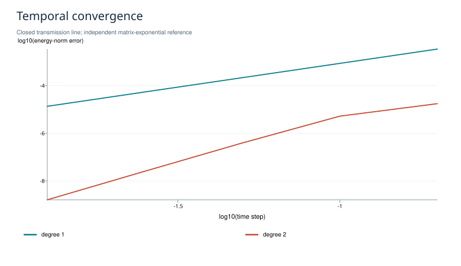
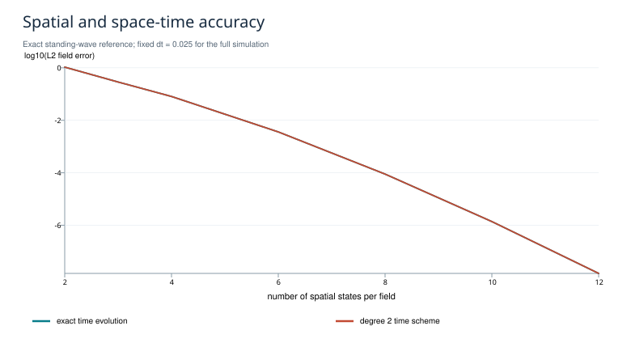
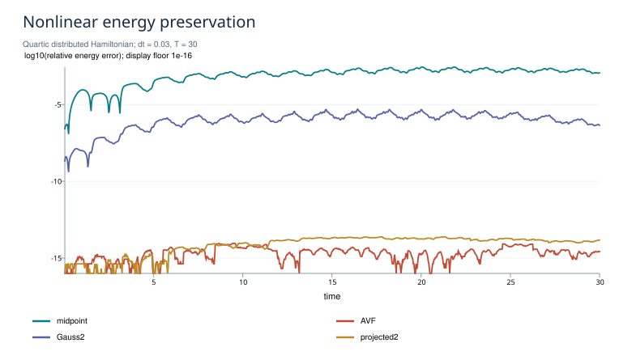
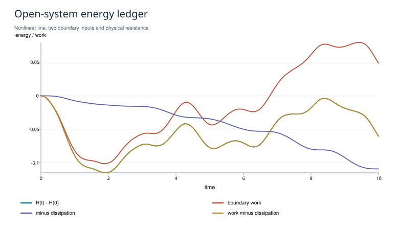
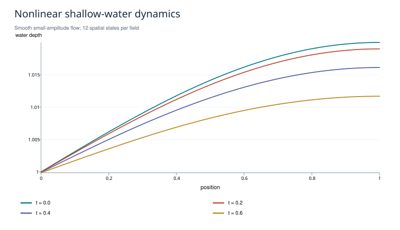
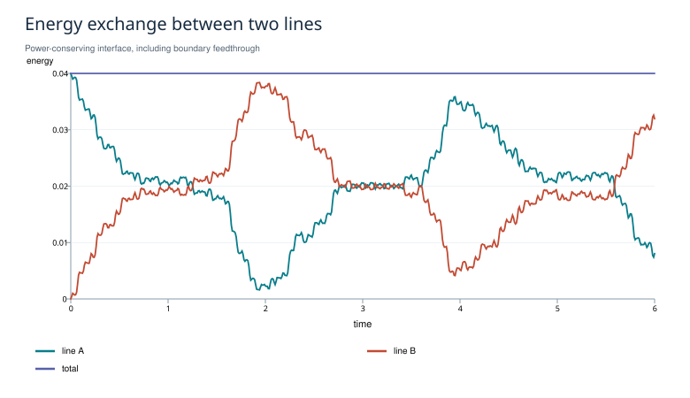

# Discrétisation pseudo-spectrale géométrique : théorie et simulations

Ce manuscrit rassemble la lecture de l'article de Moulla, Lefèvre et Maschke
(2012), la reconstruction de sa méthode spatiale, son couplage à une
discrétisation temporelle à efforts projetés et les simulations reproductibles
du dépôt.

La construction spatiale associe espaces polynomiaux mixtes, quotient des
efforts et traces de bord. Le couplage temporel vise le bilan

$$
H_{n+1}-H_n=\text{travail des ports}-\text{dissipation},
$$

sous les conditions de quadrature et de résolution précisées dans les preuves.
Les ingrédients temporels sont rattachés aux méthodes AVF, HBVM et
Petrov–Galerkin. Les résultats séparent reproduction de l'article, précision
des trajectoires, conservation énergétique et symplecticité.

Le texte, ses démonstrations, ses figures et sa bibliographie se lisent ici
d'un seul tenant. Les liens vers le code et les données permettent de vérifier
chaque expérience. Les commandes d'installation et d'exécution figurent dans
le [README du dépôt](../README.md).

## Sommaire

1. [Article de 2012 : lecture et conventions](#1-article-de-2012--lecture-et-conventions)
2. [Construction spatiale et preuves](#2-construction-spatiale-et-preuves)
3. [Discrétisation temporelle](#3-discrétisation-temporelle)
4. [Assemblage espace-temps et interconnexion](#4-assemblage-espace-temps-et-interconnexion)
5. [Protocole et résultats numériques](#5-protocole-et-résultats-numériques)
6. [Bibliographie et positionnement](#6-bibliographie-et-positionnement)

## 1. Article de 2012 : lecture et conventions

### 1.1. Source effectivement étudiée

R. Moulla, L. Lefèvre et B. Maschke, **Pseudo-spectral methods for the spatial
symplectic reduction of open systems of conservation laws**, *Journal of
Computational Physics* 231(4), 1272–1292 (2012).
[DOI](https://doi.org/10.1016/j.jcp.2011.10.008) ·
[Manuscrit HAL](https://hal.science/hal-01625008).

La lecture porte sur la copie du manuscrit HAL fournie par l'auteur :
38 pages avec couverture HAL, texte daté du 16 décembre 2010, dépôt HAL de 2017.
Les numéros d'équations, propositions et tableaux ci-dessous sont ceux de cette
copie. La version mise en page par l'éditeur n'a pas été auditée séparément.
Le dépôt contient une reconstruction et des commentaires originaux ; le fichier
source de l'article n'est pas redistribué.

### 1.2. Ce que construit l'article

| Étape | Localisation dans le manuscrit | Réalisation dans ce dépôt |
|---|---|---|
| Espaces de formes et système ouvert | §2.3, définitions 11–14 | Convention de signe et ports explicites |
| Efforts dans $\mathbb P_N$, flux et états dans $\mathbb P_{N-1}$ | (31)–(36) | LagrangeBasis, MixedDiscretization |
| Dérivation exacte et traces de bord | (36)–(38) | D, trace |
| Produit de puissance rectangulaire | (39)–(40) | M |
| Isotropie avant réduction | Proposition 18 | Test de Stokes |
| Quotient des efforts par $\ker M^\top$ | (44), proposition 20 | Efforts réduits et complétions par traces |
| Réalisation avec entrées et sorties | Proposition 21, (50) | J, B, C, S assemblés directement |
| Fermeture constitutive | §4.1 et §4.2 | Énergies quadratique, quartique, Saint-Venant |
| Spectre de la ligne idéale | §6, tableaux 1, 3, 4 | paper_spectrum.csv et test indépendant |

La propriété centrale concerne les **espaces**, le produit de puissance et le
quotient, et non une famille obligatoire de points de Gauss. La géométrie doit
survivre à un changement de coordonnées polynomiales inversible. Le programme
vérifie Gauss, Lobatto, points uniformes intérieurs et points perturbés. Les
points de Lobatto aux frontières sont une extension naturelle de l'argument
polynomial ; les nœuds sont intérieurs dans les définitions initiales du manuscrit.

Le terme « symplecticité spatiale » de l'article désigne la conservation de cette
structure après réduction. Il ne suffit pas, à lui seul, à établir la
symplecticité de l'application temporelle $x_n\mapsto x_{n+1}$.

### 1.3. Conventions vérifiées plutôt que recopiées

Nous fixons

$$
\partial_t q=-\partial_z e_p,\qquad
\partial_t p=-\partial_z e_q,\qquad
\dot H=e_q(a)e_p(a)-e_q(b)e_p(b).
$$

Avec la définition $D_{ki}=\varphi_i'(z_k)$, l'intégration par parties donne
nécessairement

$$
MD+D^\top M^\top=t_b^\top t_b-t_a^\top t_a.
$$

L'équation (43) de la copie HAL affiche le signe opposé des termes de bord
lorsqu'on la combine littéralement avec cette définition de $D$.
Le manuscrit alterne aussi certaines conventions de flux et de dérivée d'état.
Le code adopte la convention ci-dessus de bout en bout ; il ne transplante pas
isolément un signe d'une formule. Les tests évaluent indépendamment les traces,
la puissance et l'intégration par parties.

Autres précautions de lecture :

- Les facteurs de bord de (67) sont inversés par rapport aux conditions
  annoncées ; (70) donne les facteurs compatibles.
- La dernière implication de la preuve du théorème 24 doit conserver
  soigneusement la métrique de quadrature. Une antisymétrie pondérée ne donne
  pas en général une antisymétrie euclidienne par simple suppression des poids.
- La remarque 25 est explicitement une conjecture pour la collocation classique
  de Chebyshev. Le dépôt ne transforme pas cette conjecture en théorème.
- L'argument de rang utilisé ici s'appuie sur l'injectivité de la dérivée
  accompagnée d'une trace, puis sur la dimension du graphe réduit.

Ces observations concernent la copie étudiée et les conventions d'implémentation ;
elles ne remettent pas en cause la construction géométrique centrale.

### 1.4. Reproduction numérique précise

Les valeurs publiées correspondent à une longueur $\ell=2$, une capacité
$C=3$, une inductance linéique $L_{\rm ind}=2$, huit états par champ et des
entrées homogènes. La longueur est ici identifiée par les fréquences du tableau 1 :

$$
\omega_j=\frac{(j+\frac12)\pi}{\ell\sqrt{C L_{\rm ind}}},\qquad j=0,\ldots,7.
$$

Le test compare les **huit** fréquences calculées aux décimales du tableau 4,
y compris les modes élevés mal approximés par un modèle d'ordre 16.
Reproduire le tableau ne signifie pas que ses huit modes approchent tous bien
le continuum : le CSV conserve séparément l'erreur de reproduction et l'erreur
par rapport aux fréquences analytiques.

Le dépôt ne prétend pas reproduire les variantes de collocation classique
mal conditionnées des tableaux 2 et 5. Les nouveaux cas non linéaires, ouverts et
interconnectés sont identifiés comme des expériences supplémentaires.

## 2. Construction spatiale et preuves

### 2.1. Espaces, dérivée et puissance

Sur $[a,b]$, choisir deux ensembles de points distincts, sans imposer qu'ils
soient les mêmes ou emboîtés. Les bases de Lagrange associées sont

$$
\varphi_i\in\mathbb P_N,\quad i=0,\ldots,N,\qquad
\psi_k\in\mathbb P_{N-1},\quad k=0,\ldots,N-1.
$$

Les états $q,p$ et leurs dérivées temporelles utilisent $\psi$ ; les efforts
spatiaux utilisent $\varphi$. Définir

$$
D_{ki}=\varphi_i'(z_k),\qquad
M_{ik}=\int_a^b\varphi_i\psi_k\,dz,\qquad
t_a=(\varphi_i(a))_i,\quad t_b=(\varphi_i(b))_i.
$$

$D\in\mathbb R^{N\times(N+1)}$ et $M\in\mathbb R^{(N+1)\times N}$.
La dérivée d'un élément de $\mathbb P_N$ appartient exactement à
$\mathbb P_{N-1}$ ; aucune projection de la dérivée n'est nécessaire.

**Proposition S1 — Stokes discret.**

$$
MD+D^\top M^\top=t_b^\top t_b-t_a^\top t_a.
$$

**Preuve.** L'entrée $(i,j)$ du premier terme est
$\int\varphi_i\varphi_j'$ puisque l'interpolation de $\varphi_j'$ dans $\psi$
est exacte. Ajouter le terme transposé puis intégrer
$(\varphi_i\varphi_j)'$. L'identité est indépendante des points. $\square$

Pour le calcul, les polynômes sont exprimés dans une base de Legendre ; une
quadrature de Gauss à $N+1$ points intègre exactement $M$, les matrices de masse
et les produits nécessaires. Les nœuds de **quadrature** ne remplacent pas les
nœuds de **représentation** de l'utilisateur.

### 2.2. Le quotient n'est pas facultatif

La puissance interne est

$$
(e_q^{\rm full})^\top M\dot q+(e_p^{\rm full})^\top M\dot p.
$$

Elle est dégénérée sur les efforts complets. Les efforts conjugués aux
coefficients des états sont

$$
g_q=M^\top e_q^{\rm full},\qquad
g_p=M^\top e_p^{\rm full}.
$$

**Proposition S2 — Rang et complétion.** $M$ a rang $N$.
Le noyau de $M^\top$ est unidimensionnel et représente le polynôme de Legendre
de degré $N$ transporté sur $[a,b]$. Les matrices

$$
C_a=\begin{bmatrix}M^\top\\t_a\end{bmatrix},\qquad
C_b=\begin{bmatrix}M^\top\\t_b\end{bmatrix}
$$

sont inversibles.

**Preuve.** Si $Mv=0$, le polynôme $\psi v$ est orthogonal à tout
$\mathbb P_N$, donc à lui-même : il est nul. Le noyau transposé représente
donc l'orthogonal de $\mathbb P_{N-1}$ dans $\mathbb P_N$. Son générateur a
des valeurs de bord non nulles, proportionnelles à $(-1)^N$ et $1$.
Une trace élimine ce dernier degré de liberté. $\square$

Cette propriété de rang explique pourquoi deux efforts réduits et deux
entrées de bord suffisent à reconstruire les efforts complets.

### 2.3. Ports et graphe de Dirac

Choisir

$$
u=\begin{bmatrix}e_q(a)\\e_p(b)\end{bmatrix},\qquad
y=\begin{bmatrix}e_p(a)\\-e_q(b)\end{bmatrix}.
$$

À chaque évaluation :

$$
e_q^{\rm full}=C_a^{-1}\begin{bmatrix}g_q\\u_1\end{bmatrix},\qquad
e_p^{\rm full}=C_b^{-1}\begin{bmatrix}g_p\\u_2\end{bmatrix},
$$

$$
\dot q=-De_p^{\rm full},\qquad \dot p=-De_q^{\rm full}.
$$

Les sorties proviennent des mêmes traces. Cette élimination fournit

$$
\dot x=Jg+Bu,\qquad y=Cg+Su,\qquad x=(q,p).
$$

**Proposition S3 — Structure réduite.**

$$
J^\top=-J,\qquad C=B^\top,\qquad S^\top=-S.
$$

**Preuve.** S1 appliquée aux efforts reconstruits donne
$g^\top\dot x=u^\top y$ pour tout $(g,u)$. Par polarisation, la matrice

$$
\mathcal J=\begin{bmatrix}J&B\\-C&-S\end{bmatrix}
$$

est antisymétrique. Son graphe est isotrope et de dimension $2N+2$ dans
un espace de liaison de dimension $4N+4$ ; il est donc maximal isotrope.
Il définit une structure de Dirac pour le produit canonique. $\square$

Le terme $S$ n'est généralement pas nul. Le supprimer avant d'interconnecter
des sous-systèmes change les relations de bord. Le code conserve ce terme.
Il mesure l'antisymétrie brute ; aucune opération $(J-J^\top)/2$ ne vient
masquer une erreur d'assemblage.

### 2.4. Fermeture constitutive

Restreindre **l'énergie** à l'espace des états, puis la différencier :

$$
H_N(x)=\int_a^b\mathcal H(\psi q,\psi p,z)\,dz,\qquad g=\nabla H_N(x).
$$

Pour la ligne idéale :

$$
H_N=\tfrac12 q^\top Q_Cq+\tfrac12p^\top Q_Lp,\qquad
(Q_C)_{ij}=\int_a^b\frac{\psi_i\psi_j}{C(z)}\,dz.
$$

Pour Saint-Venant, dans un canal rectangulaire normalisé avec $\rho=B=1$,
les variables utilisées sont $(h,v)$, et non $(h,hv)$ :

$$
H_N(h,v)=\int_a^b\left(\tfrac g2 h_N^2+\tfrac12h_Nv_N^2\right)\,dz.
$$

Ainsi $e_h=gh+v^2/2$ et $e_v=hv$. L'énergie est cubique dans les coefficients.
La quadrature spatiale est choisie pour intégrer exactement ce polynôme,
ses gradients et sa Hessienne. Une énergie constitutive sous-intégrée est
une autre énergie discrète ; la conservation de celle-ci ne prouve pas la
précision vis-à-vis de l'énergie du continuum.

Une fermeture dissipative ajoute $-Rg$, avec $R=R^\top\succeq0$ :

$$
\dot x=(J-R)\nabla H_N+Bu,\qquad
\dot H_N=u^\top y-g^\top Rg.
$$

Pour la ligne à paramètres constants, la résistance du second champ est
$R=\operatorname{diag}(0,rM_\psi^{-1})$, où
$M_\psi=\int\psi^\top\psi$. Elle réalise le terme de courant $-r p/L_{\rm ind}$.

### 2.5. Invariance et conditionnement

Un changement de coordonnées d'état $x'=Tx$ transporte les objets selon

$$
J'=TJT^\top,\quad B'=TB,\quad S'=S,\quad
H'_N(x')=H_N(T^{-1}x').
$$

Pour une énergie quadratique,
$Q'=T^{-\top}QT^{-1}$. Les dynamiques sont similaires, les puissances et le
spectre sont identiques. Cette conclusion suppose la même fonctionnelle
constitutive, ou des quadratures qui donnent la même restriction.

Cette invariance est algébrique, pas une immunité à l'arrondi. Les nœuds
uniformes et perturbés se conditionnent mal lorsque $N$ augmente.
Les résultats publient les conditionnements et les résidus correspondants.
Gauss et Lobatto sont les choix de calcul usuels du dépôt.

## 3. Discrétisation temporelle

### 3.1. Problème et statut de la construction

Après réduction spatiale :

$$
\dot x=(J-R)\nabla H_N(x)+Bu,\qquad
y=B^\top\nabla H_N(x)+Su,
$$

avec $J^\top=-J$, $R^\top=R\succeq0$, $S^\top=-S$.
Le code traite ces matrices constantes. $H_N$ peut être non linéaire et
$u(t)$ variable. La généralisation à des matrices dépendant de l'état est
énoncée en §3.7, sans prétendre qu'elle est déjà implémentée.

Le choix temporel est une méthode à **état polynomial continu et effort
projeté**. Pour une structure constante conservative, elle appartient à la
famille AVF/HBVM. Son interprétation Petrov–Galerkin et son extension aux ports
ont des antécédents explicites, présentés dans la
[bibliographie commentée](#6-bibliographie-et-positionnement). L'apport de ce dépôt est la
construction complète, vérifiable et reproductible avec la méthode spatiale
de 2012 ; aucune priorité sur ces intégrateurs temporels n'est revendiquée.

### 3.2. Deux espaces temporels

Sur un pas $[t_n,t_n+h]$, écrire $c=(t-t_n)/h$ et choisir

$$
X(c)\in\mathbb P_s([0,1];\mathbb R^d),\quad X(0)=x_n,\qquad
V(c)=\frac1hX'(c)\in\mathbb P_{s-1}.
$$

Soient $P_0,\ldots,P_{s-1}$ les polynômes de Legendre décalés orthonormaux,
$P_0=1$, et $I_j(c)=\int_0^cP_j(\tau)\,d\tau$. Paramétrer

$$
X(c)=x_n+h\sum_{j=0}^{s-1}I_j(c)a_j,\qquad
V(c)=\sum_{j=0}^{s-1}P_j(c)a_j.
$$

La trace initiale élimine le noyau constant de la dérivée. Les inconnues
sont les $sd$ coefficients $a_j$, et
$x_{n+1}=X(1)=x_n+ha_0$.

Définir l'effort temporel par projection orthogonale :

$$
\gamma_j=\int_0^1P_j(c)\nabla H_N(X(c))\,dc,\qquad
E(c)=\sum_{j=0}^{s-1}P_j(c)\gamma_j.
$$

$E$ n'est pas en général $\nabla H_N(X)$ point par point. Il est l'effort
**conjugué au flux discret** $V$ dans le produit de puissance temporel.
Cette différence est nécessaire pour une énergie non quadratique.

### 3.3. Schéma calculable

Une quadrature positive $(c_\ell,b_\ell)_{\ell=1}^k$, exacte pour
$\mathbb P_{2s-2}$, fournit la dynamique faible

$$
a_i=\sum_{\ell=1}^k b_\ell P_i(c_\ell)
\big[(J-R)E(c_\ell)+Bu(t_n+hc_\ell)\big].
\tag{T1}
$$

Les sorties utilisées dans le travail sont

$$
Y_\ell=B^\top E(c_\ell)+Su_\ell.
\tag{T2}
$$

Dans le code, la même quadrature de Gauss calcule aussi $\gamma_i$ :

$$
\gamma_i^Q=\sum_\ell b_\ell P_i(c_\ell)\nabla H_N(X(c_\ell)).
\tag{T3}
$$

Il faut distinguer l'identité théorique avec projection exacte et
l'implémentation avec projection quadraturée.

**Proposition T1 — Bilan d'énergie d'un pas.** Supposons que les coefficients
$\gamma_i$ soient calculés exactement et que T1 soit résolu exactement. Alors

$$
\boxed{
H_N(x_{n+1})-H_N(x_n)
=h\sum_\ell b_\ell
\left[u_\ell^\top Y_\ell-E_\ell^\top R E_\ell\right].
}
\tag{T4}
$$

**Preuve.** La règle de chaîne continue appliquée au chemin polynomial donne

$$
\Delta H_N=\int_0^1\nabla H_N(X(c))^\top X'(c)\,dc
=h\sum_i\gamma_i^\top a_i.
$$

Insérer T1 et intervertir les sommes :

$$
\Delta H_N=h\sum_\ell b_\ell E_\ell^\top
\big[(J-R)E_\ell+Bu_\ell\big].
$$

Les termes $E_\ell^\top JE_\ell$ et $u_\ell^\top Su_\ell$ sont nuls.
Utiliser T2. $\square$

Sans entrée, l'énergie ne croît pas ; sans entrée ni dissipation, elle est
conservée aux **extrémités** des pas. Il n'est pas affirmé qu'elle reste
constante à tout point du polynôme intérieur. Pour interpréter le bilan comme
une inégalité de passivité avec stockage positif, $H_N$ doit être borné
inférieurement sur le domaine pertinent.

### 3.4. Règle de quadrature et cas particuliers

Si $H_N$ est un polynôme de degré total $r$, alors
$P_i(c)\nabla H_N(X(c))$ a degré au plus $rs-1$.
La quadrature de Gauss à $k$ points est donc suffisante si

$$
k\ge s,\qquad 2k\ge rs.
\tag{T5}
$$

| Énergie | Degré $r$ | État temporel $s=1$ | État temporel $s=2$ |
|---|---:|---:|---:|
| Ligne idéale | 2 | $k=1$ | $k=2$ |
| Saint-Venant rectangulaire | 3 | $k=2$ | $k=3$ |
| Ligne avec stockage quartique | 4 | $k=2$ | $k=4$ |

Avec $s=1$, l'effort est la moyenne du gradient sur le segment joignant les
deux états. On obtient AVF. Pour un Hamiltonien quadratique, cette moyenne
est le gradient au milieu ; on retrouve le point milieu implicite.

Avec $k=s$, les valeurs de l'effort projeté aux nœuds de Gauss coïncident
avec celles du gradient : le schéma est la collocation de Gauss classique.
Avec $k>s$, on obtient la réalisation HBVM$(k,s)$ pour une structure constante
conservative. Pour les problèmes autonomes lisses de cette classe, l'ordre
aux extrémités est $2s$. Les simulations mesurent effectivement les ordres 2 et 4,
avec des références de trajectoire indépendantes.

La preuve de T4 n'est pas une preuve générale d'ordre $2s$ pour toutes les
extensions non autonomes, à matrices variables ou avec contraintes. Les
affirmations d'ordre du dépôt se limitent aux classes citées et aux cas mesurés.

Pour un Hamiltonien non polynomial, aucune valeur finie de $k$ ne garantit
en général l'exactitude de T3. Il faut augmenter la quadrature ou adopter
une fermeture par gradient discret exact. Le défaut de chaîne est alors
une quantité à contrôler, pas à mettre artificiellement à zéro.

### 3.5. Certificat numérique : trois sources d'erreur

Soit $\rho_i$ le résidu de T1, avec le signe
$\rho_i=a_i-\mathrm{RHS}_i$, et définissons

$$
\varepsilon_{\rm ch}=\Delta H_N-h\sum_i(\gamma_i^Q)^\top a_i.
$$

À structure antisymétrique exacte, on a l'identité a posteriori

$$
\Delta H_N-W_n+D_n
=\varepsilon_{\rm ch}+h\sum_i(\gamma_i^Q)^\top\rho_i.
\tag{T6}
$$

En arithmétique flottante s'ajoute le défaut de la structure spatiale.
Le programme calcule séparément l'énergie aux extrémités, le travail des ports,
la dissipation, le défaut de chaîne et le résidu de Newton. Il n'obtient pas
l'énergie par cumul du bilan qu'il est censé vérifier.

Le solveur est Newton avec Hessienne analytique et recherche linéaire. Un
échec de convergence lève une exception. Une énergie très bien conservée
ne garantit pas une bonne phase ou une bonne trajectoire : les tableaux de
convergence et la comparaison au continuum sont donc indispensables.

Si $H_N$ est $C^2$ et l'entrée suffisamment régulière, la fonction résiduelle
en $a$ a une dérivée égale à l'identité pour $h=0$. Le théorème des fonctions
implicites donne une branche locale unique pour un pas assez petit. Ceci
n'établit ni l'existence globale de la solution implicite pour tout pas,
ni la convergence de Newton pour toute initialisation.

### 3.6. Symplecticité : propriété distincte

Pour un système fermé avec $J$ inversible, une application $\Phi_h$ est
symplectique si

$$
(D\Phi_h)^\top J^{-1}D\Phi_h=J^{-1}.
$$

Les schémas de Gauss satisfont cette propriété, mais ne conservent pas
généralement un Hamiltonien non quadratique. Les variantes AVF/HBVM retenues
conservent l'énergie polynomiale avec la quadrature adéquate, mais ne sont
pas généralement symplectiques. Le dépôt mesure ces deux défauts sur un
oscillateur quartique avec une matrice tangente obtenue par différentiation
implicite, elle-même vérifiée par différences finies.

La conservation énergétique ne suffit pas non plus à établir la préservation
de tous les Casimirs, la positivité de la hauteur d'eau, l'absence d'oscillations,
ou la stabilité d'un système non coercif.

### 3.7. Extension algébrique aux matrices variables

Remplacer, dans T1, $J,R,B,S$ par leurs valeurs à $X(c_\ell)$.
Si $J(X)^\top=-J(X)$, $R(X)\succeq0$ et $S(X)^\top=-S(X)$ à chaque étage,
la même preuve donne T4 avec les matrices d'étage : elle n'a utilisé
l'antisymétrie et la positivité que point par point.

Cela exige toujours la projection de l'effort dans **tous** les termes de
puissance et une quadrature exacte de cette projection lorsque l'on revendique
un bilan exact. La régularité, l'ordre et la résolution des équations résultantes
restent à analyser pour le modèle considéré. Le solveur actuel, dont la
Jacobienne exploite des matrices constantes, ne met pas cette extension en œuvre.

## 4. Assemblage espace-temps et interconnexion

### 4.1. Pourquoi un produit tensoriel ne suffit pas

La dérivation exacte et une identité de Stokes discrète règlent la géométrie
**bilinéaire**. Elles ne créent pas automatiquement la règle de chaîne d'un
Hamiltonien non quadratique. Une construction complète comporte donc :

1. un complexe polynomial compatible et ses traces ;
2. un quotient des efforts donnant un produit de puissance non dégénéré ;
3. une fermeture constitutive issue de l'énergie spatiale ;
4. une fermeture temporelle par effort projeté ;
5. des ports évalués avec ce même effort.

L'intégrateur réalise les points 3–5 sur chaque tranche temporelle.
Les identités tensorielles ci-dessous vérifient les points 1–2 au niveau
géométrique. Les tests de tensorisation sont distincts des simulations dynamiques.

### 4.2. Complexe polynomial du rectangle

Notons $E_t=\mathbb P_s$, $F_t=\mathbb P_{s-1}\,dt$,
$E_z=\mathbb P_N$, $F_z=\mathbb P_{N-1}\,dz$. Sur une tranche :

$$
V^0=E_t\otimes E_z,\qquad
V^1=(F_t\otimes E_z)\oplus(E_t\otimes F_z),\qquad
V^2=F_t\otimes F_z.
$$

Avec les orientations $dt,dz$, les matrices du complexe sont

$$
d_0=
\begin{bmatrix}
D_t\otimes I_{E_z}\\ I_{E_t}\otimes D_z
\end{bmatrix},\qquad
d_1=
\begin{bmatrix}
-I_{F_t}\otimes D_z&D_t\otimes I_{F_z}
\end{bmatrix}.
$$

**Proposition ST1.** $d_1d_0=0$.

**Preuve.** Les deux termes du produit sont
$-D_t\otimes D_z$ et $D_t\otimes D_z$. Ils s'annulent exactement.
La propriété n'utilise pas une famille particulière de nœuds. $\square$

### 4.3. Identité de bord sur la tranche

Pour $\alpha\in\{t,z\}$, poser

$$
S_\alpha=M_\alpha D_\alpha,\qquad
G_\alpha=\int\varphi_\alpha^\top\varphi_\alpha,\qquad
B_\alpha=t_{\alpha,+}^\top t_{\alpha,+}
-t_{\alpha,-}^\top t_{\alpha,-}.
$$

Le symbole $S_\alpha$ désigne ici une matrice d'intégration par parties,
sans rapport avec le terme de transmission directe $S$ des ports.
Les matrices unidimensionnelles satisfont
$S_\alpha+S_\alpha^\top=B_\alpha$. Il en découle

$$
\mathcal K=S_t\otimes G_z+G_t\otimes S_z,
$$

$$
\boxed{\mathcal K+\mathcal K^\top
=B_t\otimes G_z+G_t\otimes B_z.}
$$

**Preuve.** Transposer les produits de Kronecker et utiliser la symétrie
de $G_t,G_z$. $\square$

Le membre droit contient les faces initiale et finale ainsi que les deux
frontières spatiales. Les faces internes de deux tranches accolées
s'annulent si elles utilisent les mêmes traces avec des orientations opposées.

Il s'agit d'une identité exacte sur les espaces polynomiaux, pas d'une preuve
de conservation multisymplectique pour toutes les fermetures non linéaires.
Une loi multisymplectique requerrait l'étude des variations et des deux-formes
associées à la dynamique discrète. Elle n'est pas revendiquée ici.

### 4.4. Théorème de bilan pour la simulation complète

**Proposition ST2.** Sous les hypothèses des propositions S1–S3 et T1, pour
des pas $h_n>0$, la simulation satisfait

$$
H_N(x_M)-H_N(x_0)
=\sum_{n=0}^{M-1}h_n\sum_\ell b_\ell
\left[u_{n\ell}^\top Y_{n\ell}
-E_{n\ell}^\top R E_{n\ell}\right].
$$

**Preuve.** La réduction spatiale donne les matrices de S3 et la fermeture
$g=\nabla H_N$. Appliquer T4 sur chaque tranche et sommer : les énergies
aux extrémités internes se télescopent. $\square$

Le bilan reste valable avec des pas variables, sous les mêmes conditions
d'intégration et de résolution à chaque pas. Il concerne $H_N$, donc
l'énergie du modèle spatial discret ; l'erreur vis-à-vis du continuum est
évaluée séparément.

### 4.5. Composition de systèmes ouverts

Assembler plusieurs systèmes par blocs diagonaux, puis connecter les ports
avec

$$
u=Ky+v,\qquad K^\top=-K.
$$

Au niveau de chaque étage, $u^\top y=v^\top y$ : l'interconnexion n'injecte
aucune puissance. Comme $y=B^\top E+Su$,

$$
(I-KS)u=KB^\top E+v.
$$

Si $I-KS$ est inversible, poser $F=(I-KS)^{-1}$. Le système composé est

$$
J_{\rm c}=J+BFKB^\top,\qquad
B_{\rm c}=BF,\qquad S_{\rm c}=SF.
$$

On conserve $R$ et on additionne les Hamiltoniens.
Les identités $FK=KF^\top$ et $SF=F^\top S$ donnent
$J_{\rm c}^\top=-J_{\rm c}$, $S_{\rm c}^\top=-S_{\rm c}$ ; la sortie
s'exprime comme $B_{\rm c}^\top E+S_{\rm c}v$.

**Proposition ST3.** La somme des bilans T4 des composants est le bilan
du système composé si les composants partagent les mêmes étages temporels
et la même quadrature de puissance.

**Preuve.** Les puissances internes sont annulées par $y^\top Ky=0$
à chaque étage, avant la sommation en temps. $\square$

L'expérience connecte la frontière droite de la ligne A à la frontière gauche
de la ligne B : continuité du courant et de la tension, avec les orientations
définies en §2.3. Les deux autres ports ont des entrées nulles.
L'énergie passe réellement d'une ligne à l'autre.

Si $I-KS$ est singulière, il ne faut pas remplacer l'inverse par une
pseudo-inverse arbitraire : des contraintes peuvent apparaître et requérir
une formulation PH différentielle-algébrique. Le programme signale ce cas.
Les interconnexions avec des horloges différentes ne sont pas prises en charge.

### 4.6. Ce qui reste un travail de recherche

| Sujet | Statut de cette version |
|---|---|
| Géométrie spatiale 1D à points arbitraires | Démonstration et code |
| Bilan d'énergie temporel non linéaire | Démonstration, code et simulations |
| Complexe et Stokes tensoriels | Identités démontrées et vérifiées |
| Interconnexion synchrone avec ports | Démonstration et simulation |
| PH à matrices variables | Bilan algébrique démontré, solveur non implémenté |
| PH avec contraintes algébriques | Non résolu dans cette version |
| Géométries spatiales 2D/3D | Non implémentées |
| Chocs et positivité garantie de Saint-Venant | Non établis |
| Multisymplecticité du schéma complet | Non revendiquée |
| Nouveauté mathématique publiable | Non établie par cette seule construction |

Le prolongement le plus concret consiste à préserver la composition énergétique
avec des pas différents entre sous-domaines : la cancellation de puissance
doit alors être transportée entre espaces temporels distincts, plutôt que
supposée à des étages communs.

## 5. Protocole et résultats numériques

Résultats exécutés le 10 octobre 2026 par
[experiments/reproduce.py](../experiments/reproduce.py). Le
[manifeste](../results/manifest.json) conserve les versions de Python et NumPy,
la plateforme et les empreintes SHA-256 des sources de calcul.

### 5.1. Reproduction de l'article

Ligne idéale : $\ell=2$, $C=3$, $L_{\rm ind}=2$, $N=8$, ports homogènes.
Les huit fréquences du tableau 4 sont retrouvées pour quatre familles de
points. L'écart maximal aux décimales publiées est $1.26\,10^{-12}$.

Les transformations entre les coordonnées de Gauss et les coordonnées
perturbées donnent un défaut relatif de $2.07\,10^{-13}$ pour $J$ et de
$2.47\,10^{-15}$ pour $Q$. Les quadratures constitutives sont exactes.

[Fréquences et erreurs par rapport au continuum](../results/tables/paper_spectrum.csv).

### 5.2. Géométrie et conditionnement

| Vérification | Résultat |
|---|---:|
| Défaut relatif de Dirac maximal, quatre familles, $N\le12$ | $4.59\,10^{-11}$ |
| Même mesure à $N=16$ | $1.91\,10^{-8}$ |
| Identité de Stokes tensorielle | $1.02\,10^{-14}$ |
| Identité $d_1d_0=0$, résidu normalisé | $7.78\,10^{-18}$ |

La dégradation à $N=16$ vient des coordonnées uniformes ou perturbées :
le conditionnement d'une complétion atteint environ $4.1\,10^8$.
Cela ne contredit pas l'invariance en arithmétique exacte. Le seuil
$10^{-8}$ de la validation structurelle est appliqué explicitement à
$N\le12$ ; les résultats à $N=16$ restent publiés.
Les simulations temporelles utilisent les coordonnées de Gauss.

[Structure et conditionnements](../results/tables/spatial_structure.csv) ·
[Complexe espace-temps](../results/tables/space_time_geometry.csv).

### 5.3. Convergence de trajectoire

La convergence temporelle linéaire est mesurée à espace fixé contre
l'exponentielle du modèle semi-discret, calculée indépendamment par
diagonalisation dans les coordonnées énergétiques.

La convergence temporelle non linéaire utilise un RK4 explicite fin, indépendant
du solveur implicite. Le passage de 6 000 à 12 000 pas change l'état de
référence de $2.86\,10^{-14}$ en norme euclidienne.

| Modèle | Degré temporel | Ordre mesuré sur les deux derniers pas |
|---|---:|---:|
| Ligne idéale | 1 | 1.999 |
| Ligne idéale | 2 | 3.986 |
| Ligne quartique | 1 | 2.000 |
| Ligne quartique | 2 | 3.987 |

Une onde stationnaire analytique mesure séparément l'erreur spatiale
et l'erreur espace-temps. À $N=12$, l'erreur spatiale $L^2$ est
$1.46\,10^{-8}$ ; avec le degré temporel 2 et $h=0.025$,
l'erreur totale est également de l'ordre de $1.46\,10^{-8}$.
Il s'agit d'un cas analytique lisse, pas d'une estimation uniforme pour
toute équation PH.

[Temps](../results/tables/time_convergence.csv) ·
[Non linéaire](../results/tables/nonlinear_convergence.csv) ·
[Espace](../results/tables/space_convergence.csv).

### 5.4. Hamiltonien quartique : contrôles positifs et négatifs

Modèle fermé normalisé :

$$
H_N=\int_0^1\left[\tfrac12(q_N^2+p_N^2)+\tfrac14q_N^4\right]dz.
$$

$N=6$, $h=0.03$, 1 000 pas, $T=30$.
Cette expérience évalue l'intégration du modèle semi-discret ; elle ne
constitue pas une étude de convergence PDE à cet horizon.

| Méthode | $(s,k)$ | Maximum de l'erreur relative d'énergie |
|---|---:|---:|
| Point milieu | (1,1) | $2.71\,10^{-3}$ |
| AVF quadraturé exactement | (1,2) | $9.23\,10^{-15}$ |
| Gauss à deux étages | (2,2) | $4.92\,10^{-6}$ |
| Effort projeté, degré 2 | (2,4) | $2.42\,10^{-14}$ |

L'oscillateur quartique distingue énergie et symplecticité. Sur un pas de
taille $0.2$, le point milieu a un défaut symplectique $2.86\,10^{-17}$ mais
une erreur d'énergie $2.88\,10^{-4}$. AVF conserve l'énergie à l'arrondi près
mais a un défaut symplectique $2.58\,10^{-3}$.

[Mesures sur l'oscillateur](../results/tables/symplectic_vs_energy.csv).

### 5.5. Ports actifs et dissipation

Même stockage quartique, résistance $r=0.15$ sur le second champ,
deux entrées temporelles non nulles, $h=0.02$, $T=10$, méthode $(s,k)=(2,4)$.
L'énergie est calculée directement à partir de l'état ; le travail et la
dissipation sont intégrés indépendamment aux étages.

$$
\max_n|H_n-H_0-W_{0:n}+D_{0:n}|=1.23\,10^{-15}.
$$

La dissipation totale vaut environ $0.10906$ et tous ses incréments sont
positifs. Le défaut maximal du bilan sur un pas est $5.42\,10^{-17}$.

[Bilan pas à pas](../results/tables/forced_damped.csv).

### 5.6. Saint-Venant non linéaire

Canal rectangulaire normalisé, $g=1$, $N=12$ :

$$
h(z,0)=1+0.02\sin(\pi z/2),\qquad v(z,0)=0.
$$

L'entrée gauche impose l'effort de Bernoulli $e_h=1$ ; la droite impose
le débit $e_v=0$. Le bilan tient compte du travail effectif de la frontière
gauche. Méthode $(s,k)=(2,3)$, $h_t=0.002$, $T=0.6$.

- Défaut cumulé du bilan : $4.24\,10^{-16}$.
- Résidu du champ de vecteurs à l'eau au repos : $8.15\,10^{-13}$.
- Hauteur minimale sur 401 points à chaque extrémité temporelle : $0.999866$.
- Écart RMS final des hauteurs avec $N=18$ et $h_t=0.001$ : $3.30\,10^{-7}$.

La hauteur positive **échantillonnée** n'est pas une preuve de positivité
sur tout l'intervalle ni entre les pas. Le raffinement compare simultanément
l'espace et le temps : il ne mesure pas séparément leurs ordres.
L'expérience reste lisse ; aucun choc, fond sec ou ressaut n'est traité.

[Bilan](../results/tables/shallow_water_ledger.csv) ·
[Profils](../results/tables/shallow_water_profiles.csv).

### 5.7. Interconnexion

Deux lignes, $N_A=6$, $N_B=5$, coefficients constitutifs différents.
L'énergie initiale est uniquement dans A. Le terme de transmission directe
des ports est conservé lors de l'élimination.

- Défaut maximal du bilan total : $3.47\,10^{-16}$.
- Défaut maximal de cancellation des puissances internes : $8.33\,10^{-17}$.
- Énergie maximale atteinte dans B : $0.03839$.

[Données](../results/tables/interconnection.csv).

### 5.8. Portée de la validation

Les tests unitaires examinent les identités et plusieurs erreurs possibles :
sous-intégration, mauvais ports, confusion énergie/symplecticité et échec de
Newton. Les 22 critères globaux sont définis dans validate() et consignés
dans [summary.json](../results/summary.json).

Les seuils sont explicites et tolèrent les différences d'arrondi entre
plateformes. Ils valident les expériences et les identités indiquées,
avec les hypothèses des sections 2 à 4, et ne constituent pas une
certification générale des modèles PH.

## 6. Bibliographie et positionnement

Consultation effectuée le 10 octobre 2026. Cette liste est ciblée sur la
construction du dépôt ; elle ne prétend pas établir une priorité par une
revue exhaustive de toute la littérature.

### 6.1. Source spatiale

**Moulla, Lefèvre, Maschke (2012).** *Pseudo-spectral methods for the spatial
symplectic reduction of open systems of conservation laws*. JCP 231(4),
1272–1292. [DOI](https://doi.org/10.1016/j.jcp.2011.10.008).

Source directe : espaces mixtes, produit rectangulaire, quotient et ports.
Le manuscrit HAL complet a été lu. L'audit et la correspondance avec le code
sont dans [la section 1](#1-article-de-2012--lecture-et-conventions).

### 6.2. Intégration temporelle

**Hairer (2010).** *Energy-preserving variant of collocation methods*.
[Texte de l'auteur](https://www.unige.ch/~hairer/preprints/crete.pdf).

Développe des variantes de collocation prolongeant AVF à ordre élevé.
Ce travail distingue conservation de l'énergie et propriétés symplectiques.
Le dépôt reprend cette distinction dans ses contrôles négatifs.

**Brugnano, Iavernaro, Trigiante.** *Analysis of Hamiltonian Boundary Value
Methods (HBVMs): A class of energy-preserving Runge–Kutta methods for the
numerical solution of polynomial Hamiltonian systems*.
[Prépublication 2009](https://arxiv.org/abs/0909.5659) ·
[Publication 2015](https://doi.org/10.1016/j.cnsns.2014.05.030).

Les cas conservatifs à matrice constante de notre intégrateur relèvent des
HBVM$(k,s)$. Le degré du chemin et le nombre de points de quadrature jouent
des rôles différents : augmenter la quadrature peut rendre le bilan exact
sans augmenter le nombre d'inconnues polynomiales.

**Celledoni, Høiseth (2017, prépublication).** *Energy-Preserving and
Passivity-Consistent Numerical Discretization of Port-Hamiltonian Systems*.
[arXiv](https://arxiv.org/abs/1706.08621).

Présente des discrétisations par gradients discrets et par séparation
d'opérateurs, avec passivité discrète. C'est un antécédent direct à toute
revendication générale d'intégration PH conservant l'énergie.

**Kotyczka, Lefèvre (2018, prépublication).** *Discrete-time port-Hamiltonian
systems: A definition based on symplectic integration*.
[arXiv](https://arxiv.org/abs/1811.07852).

Construit une structure de Dirac en temps discret par collocation et
intégration symplectique ; distingue bilan discret et erreur énergétique.
Ce cadre ne justifie pas d'appeler « exact » le bilan de l'énergie originale
d'un Hamiltonien non quadratique sous une quadrature insuffisante.

**Giesselmann, Karsai, Tscherpel (2025).** *Energy-consistent Petrov–Galerkin
time discretization of port-Hamiltonian systems*. SMAI-JCM 11, 335–367.
[Article](https://smai-jcm.centre-mersenne.org/articles/10.5802/smai-jcm.127/) ·
[Texte intégral](https://smai-jcm.centre-mersenne.org/item/10.5802/smai-jcm.127.pdf).

Le schéma 2.2 et la proposition 2.5 projettent l'effort pour obtenir un bilan
aux extrémités temporelles. La remarque 2.4 traite des opérateurs dépendant
de l'état. Le texte distingue projection exacte et quadrature numérique.
Cette proximité est explicite : la projection temporelle n'est pas une idée
nouvelle du présent dépôt. Leur cadre inclut des opérateurs non linéaires
au-delà de l'implémentation matricielle constante livrée ici.

### 6.3. Contribution concrète de cette version

- Reconstruction traçable de la méthode spatiale de 2012.
- Raccordement explicite de ses quotients, ports et énergie à un intégrateur
  temporel compatible.
- Bilan espace-temps avec conditions de quadrature démontrées.
- Simulations distinguant reproduction, précision, structure, énergie,
  passivité et symplecticité.

Une publication nouvelle demanderait un résultat supplémentaire différenciant :
composition avec grilles temporelles différentes, traitement de contraintes
PH, ou convergence uniforme en espace et en temps. Aucun de ces résultats
n'est annoncé comme déjà obtenu.
